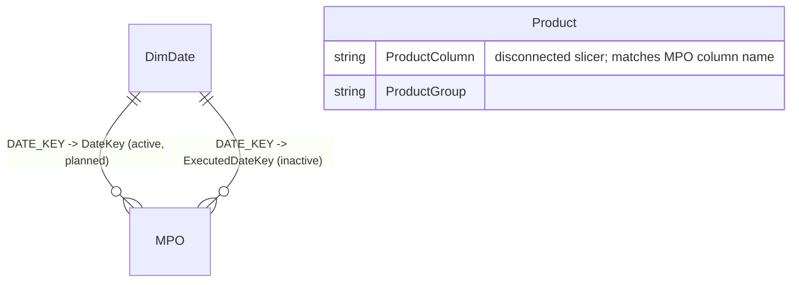

# GTM – Power BI Data Model (Banker_locator_V1), 3-query version
The model uses three native SQL queries in Power BI (`powerbi_queries/`). Connection: DirectQuery to <SQL_SERVER> / <REPORT_DB>. Every query is a plain SELECT, since the user has read-only rights. Counts only.

| Table | File | Storage | Grain |
|---|---|---|---|
| MPO | MPO.sql | DirectQuery | 1 row per approved activity (Id) |
| DimDate | DimDate.sql (<DATE_SCHEMA>.DIM_DATE) | Dual | day |
| Product | Product.sql (VALUES map + <STAGING_DB>.dbo.<PRODUCT_LOOKUP_TABLE>), or Product_DATATABLE.dax | Dual / Import | lookup row, with its ProductColumn |

## Business rules (in MPO.sql)
- **Filter:** IsActive=1, StatusId=2 (approved), [Date] >= '2025-01-01' (sargable).
- **Planned date:** DateKey = [Date].
- **Executed:** IsExecuted = ExecutedAt IS NOT NULL, and ExecutedDateKey comes from ExecutedAt. A NULL ExecutedAt means not executed. There is no fallback to the planned date.
- **Sales:** HasSale = TotalSaleCount > 0, using the 10 ISNULL'd product columns.
- **Columns:**
  - Region = Province.
  - Company = Store, or the free-text Other value when Store='Other'. This is a data-quality issue.
  - SourceOfOpportunity is text, from a LEFT JOIN on SizeOfOpportunity.
- **Dropped:** Executed_Concat, ExecutedDay/Year/Month and the Yes/No Executed text. DimDate covers these.

## Diagram


## Why Product is disconnected
MPO stores sales in 10 wide columns, so there is no key Product could relate to. Product is therefore a **disconnected slicer table**. The measures read the selected `Product[ProductColumn]` values and add up the matching MPO columns with SWITCH. Unpivoting into a separate sales fact would avoid this, but the user wants only 3 queries.

## Build in Power BI Desktop
1. **Connect:** Get Data > SQL Server.
   - Server `<SQL_SERVER>`, Database `<REPORT_DB>`, **DirectQuery**.
   - Advanced options > SQL statement: paste the file.
   - Load without any Power Query steps. Do this three times and name the tables MPO, DimDate and Product.
2. **Storage modes:** MPO = DirectQuery, DimDate = Dual, Product = Dual. If cross-database access fails, create Product from `Product_DATATABLE.dax` as an Import table instead.
3. **Relationships** (Many-to-one, single direction):
   - DimDate[DATE_KEY] 1:* MPO[DateKey], **active**.
   - DimDate[DATE_KEY] 1:* MPO[ExecutedDateKey], **inactive**.
   - Product has no relationships.
4. **Date table:** Mark DimDate as the date table on ACTUAL_DATE. Sort MONTH_NAME by MONTH.
5. **Slicers:**
   - Year/Month/Day come from DimDate.
   - BU, Region, MicroMarket, Branch, BankerName, Company and SourceOfOpportunity come straight from MPO columns.
   - Product Group / Product come from Product[ProductGroup] / Product[ProductLabel] or REPORTINGPRODUCTNAME.
   - Hierarchy on MPO: BusinessUnit > Region > MicroMarket > Branch > BankerName.
6. **Hide** ActivityId, DateKey, ExecutedDateKey, IsExecuted, HasSale, the 10 product columns, TotalSaleCount and Product[ProductColumn]. Use the measures instead. Turn on the slicer Apply button.

## Measures
```DAX
Planned Activities = COUNTROWS ( MPO )

Executed Activities = SUM ( MPO[IsExecuted] )        -- by planned date

Executed (Exec Date) =
CALCULATE ( [Executed Activities], USERELATIONSHIP ( DimDate[DATE_KEY], MPO[ExecutedDateKey] ) )

Not Executed = [Planned Activities] - [Executed Activities]

-- Sales Count: sums the MPO columns that match the selected products (all 10 when nothing is selected)
Sales Count =
SUMX (
    DISTINCT ( Product[ProductColumn] ),
    SWITCH (
        Product[ProductColumn],
        "MiGoals",        SUM ( MPO[MiGoals] ),
        "MiGoalsPlus",    SUM ( MPO[MiGoalsPlus] ),
        "MiGoalsPremium", SUM ( MPO[MiGoalsPremium] ),
        "PlIntake",       SUM ( MPO[PlIntake] ),
        "OdApp",          SUM ( MPO[OdApp] ),
        "CcApp",          SUM ( MPO[CcApp] ),
        "Investments",    SUM ( MPO[Investments] ),
        "FPFixed",        SUM ( MPO[FPFixed] ),
        "FPBYO",          SUM ( MPO[FPBYO] ),
        "FPMCL",          SUM ( MPO[FPMCL] )
    )
)

-- Activities with at least one sale in the selected products
Activities With Sales =
IF (
    NOT ISFILTERED ( Product ),
    SUM ( MPO[HasSale] ),
    VAR Cols = DISTINCT ( Product[ProductColumn] )
    RETURN
        COUNTROWS (
            FILTER (
                MPO,
                ( "MiGoals"        IN Cols && MPO[MiGoals] > 0 )
                || ( "MiGoalsPlus"    IN Cols && MPO[MiGoalsPlus] > 0 )
                || ( "MiGoalsPremium" IN Cols && MPO[MiGoalsPremium] > 0 )
                || ( "PlIntake"       IN Cols && MPO[PlIntake] > 0 )
                || ( "OdApp"          IN Cols && MPO[OdApp] > 0 )
                || ( "CcApp"          IN Cols && MPO[CcApp] > 0 )
                || ( "Investments"    IN Cols && MPO[Investments] > 0 )
                || ( "FPFixed"        IN Cols && MPO[FPFixed] > 0 )
                || ( "FPBYO"          IN Cols && MPO[FPBYO] > 0 )
                || ( "FPMCL"          IN Cols && MPO[FPMCL] > 0 )
            )
        )
)

-- Previous year / MoM pattern (apply to any measure)
Planned PY      = CALCULATE ( [Planned Activities], SAMEPERIODLASTYEAR ( DimDate[ACTUAL_DATE] ) )
Planned PM      = CALCULATE ( [Planned Activities], DATEADD ( DimDate[ACTUAL_DATE], -1, MONTH ) )
Planned MoM %   = DIVIDE ( [Planned Activities] - [Planned PM], [Planned PM] )
Sales Count PY  = CALCULATE ( [Sales Count], SAMEPERIODLASTYEAR ( DimDate[ACTUAL_DATE] ) )
Sales Count PM  = CALCULATE ( [Sales Count], DATEADD ( DimDate[ACTUAL_DATE], -1, MONTH ) )
Executed PY (Exec Date) =
CALCULATE ( [Executed (Exec Date)], SAMEPERIODLASTYEAR ( DimDate[ACTUAL_DATE] ) )
```
- **Sales on the executed date:** wrap the measure in `CALCULATE(..., USERELATIONSHIP(DimDate[DATE_KEY], MPO[ExecutedDateKey]))`.
- **Fewer measures:** a calculation group (Current/PY/PM/MoM %) avoids repeating each measure.
- **Product slicer scope:** it affects only Sales Count and Activities With Sales. Planned/Executed ignore product.

## Performance and later steps
- **DirectQuery cost:** native queries are re-run as subqueries for every visual. The FILTER over MPO in Activities With Sales becomes a WHERE clause; check it with Performance Analyzer.
- **When a DBA can help:** move MPO into a view or persisted table, add an index on [Date], and consider an unpivoted sales table so Product can relate normally.
- **Alternative:** Import mode, if refresh latency is acceptable.

## RLS (later)
Add a role on MPO, e.g. `MPO[Region] IN CALCULATETABLE(VALUES(Sec[Region]), Sec[UPN] = USERPRINCIPALNAME())`, using a small security table.

## Visual notes
- **Palette:** Corporate dark green #005B33 / #006341, accent #78BE20, white background.
- **Layout:**
  - KPI cards with PY and MoM
  - org matrix
  - company table
  - daily chart
