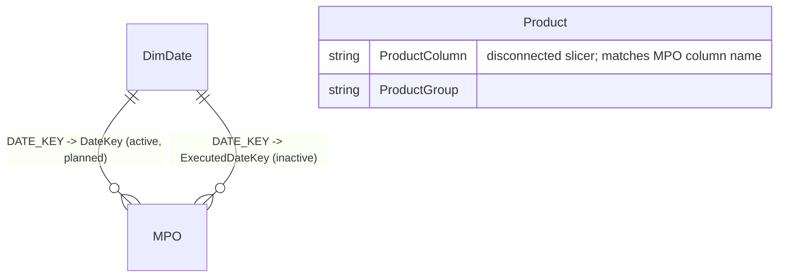

# GTM – Power BI Data Model (Banker_locator_V1), 3-query version
The model uses three native SQL queries in Power BI (`powerbi_queries/`). Connection: DirectQuery to <SQL_SERVER> / <REPORT_DB>. Every query is a plain SELECT, since the user has read-only rights. Counts only.

| Table | File | Storage | Grain |
|---|---|---|---|
| MPO | MPO.sql | DirectQuery | 1 row per approved activity (Id) |
| DimDate | DimDate.sql (<DATE_SCHEMA>.DIM_DATE) | Dual | day |
| Product | Product.sql (VALUES map + <STAGING_DB>.dbo.<PRODUCT_LOOKUP_TABLE>), or Product_DATATABLE.dax | Dual / Import | lookup row, with its ProductColumn |

## Business rules (in MPO.sql)
- **Filter:** IsActive=1, StatusId=2 (approved), [Date] >= '2025-01-01' (sargable).
- **Planned date:** DateKey = [Date].
- **Executed:** driven by the source flag. MPO[Executed] is text 'Yes'/'No' (from MPO.Executed = 1). IsExecuted and HasSale follow Executed = 'Yes'. ExecutedDateKey comes from ExecutedAt and is filled only for executed rows; it is used only for the executed-date axis. Measures filter MPO[Executed] = "Yes".
- **Sales:** HasSale = TotalSaleCount > 0, using the 10 ISNULL'd product columns.
- **Columns:**
  - Region = Province.
  - Company = Store, or the free-text Other value when Store='Other'. This is a data-quality issue.
  - SourceOfOpportunity is text, from a LEFT JOIN on SizeOfOpportunity.
- **Dropped:** Executed_Concat, ExecutedDay/Year/Month and the Yes/No Executed text. DimDate covers these.

## Diagram

## Why Product is disconnected
MPO stores sales in 10 wide columns, so there is no key Product could relate to. Product is therefore a **disconnected slicer table**. The measures read the selected `Product[ProductColumn]` values and add up the matching MPO columns with SWITCH. Unpivoting into a separate sales fact would avoid this, but the user wants only 3 queries.

## Build in Power BI Desktop
1. **Connect:** Get Data > SQL Server.
   - Server `<SQL_SERVER>`, Database `<REPORT_DB>`, **DirectQuery**.
   - Advanced options > SQL statement: paste the file.
   - Load without any Power Query steps. Do this three times and name the tables MPO, DimDate and Product.
2. **Storage modes:** MPO = DirectQuery, DimDate = Dual, Product = Dual. If cross-database access fails, create Product from `Product_DATATABLE.dax` as an Import table instead.
3. **Relationships** (Many-to-one, single direction):
   - DimDate[DATE_KEY] 1:* MPO[DateKey], **active**.
   - DimDate[DATE_KEY] 1:* MPO[ExecutedDateKey], **inactive**.
   - Product has no relationships.
4. **Date table:** Mark DimDate as the date table on ACTUAL_DATE. Sort by column: MONTH_NAME and MONTH_SHORT_NAME by MONTH; DAY_NAME and DAY_SHORT_NAME by DAY_IN_WEEK; MONTH_SORT_LABEL needs none. Optionally sort YEAR_MONTH_KEY-based labels by YEAR_MONTH_KEY.
5. **Slicers:**
   - Year/Month/Day come from DimDate.
   - BU, Region, MicroMarket, Branch, BankerName, Company and SourceOfOpportunity come straight from MPO columns.
   - Product Group / Product come from Product[ProductGroup] / Product[ProductLabel] or REPORTINGPRODUCTNAME.
   - Hierarchy on MPO (confirmed, all columns exist in MPO.sql, blanks shown as 'Unknown'): BusinessUnit > Region (source Province) > MicroMarket > Branch > BankerName.
6. **Hide** ActivityId, DateKey, ExecutedDateKey, IsExecuted, HasSale, the 10 product columns, TotalSaleCount and Product[ProductColumn]. For the full, current measure list, see `dax/measures.dax`; this doc doesn't keep a copy. Use the measures instead. Turn on the slicer Apply button.

## Measures
**Measures are owned by the DAX Analyst. The source of truth is `dax/measures.dax`** (also see `dax/measures_guide.md`). This doc no longer repeats the DAX. Model rules the measures rely on: the key is MPO[ActivityId]; executed means MPO[Executed] = "Yes"; the executed-date axis comes from USERELATIONSHIP(DimDate[DATE_KEY], MPO[ExecutedDateKey]); Product is disconnected and is read through Product[ProductColumn]. For the full, current measure list, see `dax/measures.dax`; this doc doesn't keep a copy.

- **Sales on the executed date:** wrap the measure in `CALCULATE(..., USERELATIONSHIP(DimDate[DATE_KEY], MPO[ExecutedDateKey]))`.
- **Fewer measures:** a calculation group (Current/PY/PM/MoM %) avoids repeating each measure.
- **Product slicer scope:** right now the product slicer does not change any measure. Sales Count and Activities With Sales use TotalSaleCount until the product mapping (OdApp, CcApp, Investments, FPMCL) is confirmed and the DAX Analyst finishes 'Sales Count (Product)'. Planned and Executed will always ignore product.

## Performance and later steps
- **DirectQuery cost:** native queries are re-run as subqueries for every visual. Keep measures as simple column filters (e.g. MPO[Executed] = "Yes", TotalSaleCount > 0) so they fold into WHERE clauses; check slow visuals with Performance Analyzer.
- **When a DBA can help:** move MPO into a view or persisted table, add an index on [Date], and consider an unpivoted sales table so Product can relate normally.
- **Alternative:** Import mode, if refresh latency is acceptable.

## RLS (later)
Add a role on MPO, e.g. `MPO[Region] IN CALCULATETABLE(VALUES(Sec[Region]), Sec[UPN] = USERPRINCIPALNAME())`, using a small security table.

## Visual notes
- **Palette:** Corporate green #006341 (matches CorporateGreen.json), accent #78BE20, white background.
- **Layout:**
  - KPI cards with PY and MoM
  - org matrix
  - company table
  - daily chart
